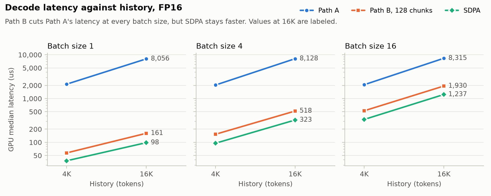
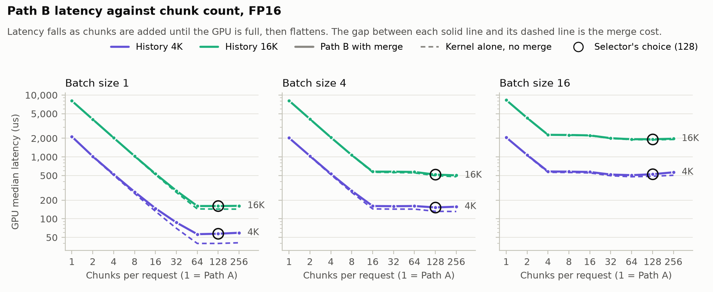
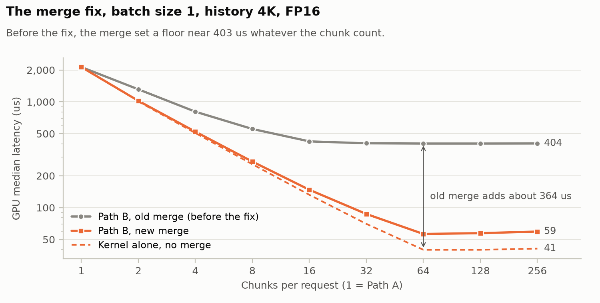
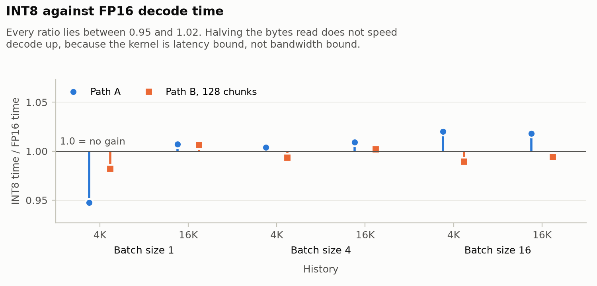
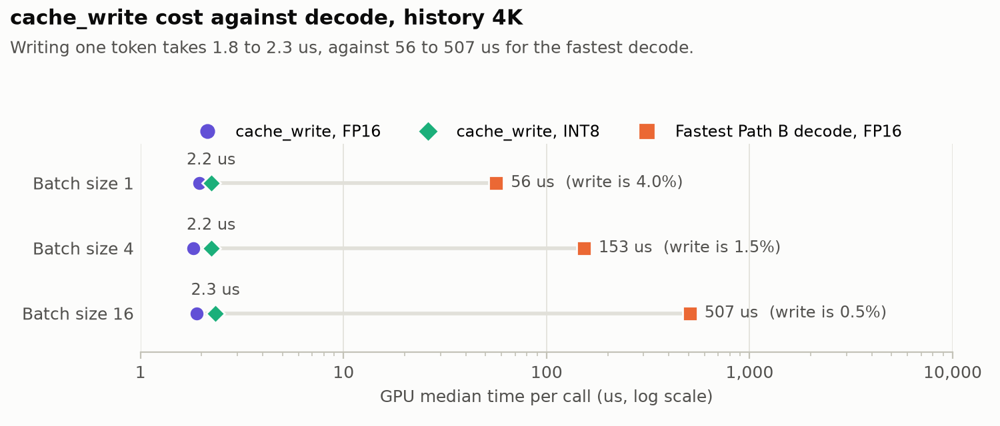

# Workload Aware CUDA Decode Attention over an INT8 Paged KV Cache

Krishna Mula. CS 259 class project. Submitted Monday, November 9, 2026.

## Abstract

Decode attention reads every token of a request's history for each new token,
so its cost is set by memory, not arithmetic. This project asks how INT8 cache
storage and the way work is divided across the GPU interact across history
lengths and batch sizes, and whether a simple selector beats one execution
configuration used everywhere. We wrote one CUDA kernel over a paged KV cache,
templated on FP16 or INT8 storage, with two modes. Path A gives each
(request, query head) pair one block over the whole history. Path B divides the
history into chunks, gives each chunk its own block, and merges the partial
states in PyTorch. We measured both on one RTX 3090 with the Qwen3-1.7B
attention shape, at batch size 1, 4 and 16 and history 4K and 16K, against
PyTorch SDPA on a gathered FP16 history. Path A is latency bound at 0.49 to
0.52 us per token, whatever the batch size. Path B at 128 chunks is 3.9 to 50.2 times
faster than Path A, and Path A never wins a measured case. SDPA is still
1.49 to 1.65 times faster than Path B, which we infer is because FlashAttention keeps more bytes
in flight per block. INT8 halves the storage (2,112 against 4,096 bytes per
token per layer) but does not change decode time: INT8 over FP16 time is 0.95
to 1.03, which we infer is because the kernel does not saturate DRAM bandwidth. A hand-set
selector, 128 chunks capped at 16 tokens per chunk, is within 3.8% of the best
chunk count in all 24 measured cases, in both grid runs. On this grid it reduces to one fixed
chunk count, so the honest answer to the selector question is that one well
chosen configuration was enough.

## 1. Motivation

A language model generates text one token at a time. For each new token, every
layer computes attention between one query vector per query head and the keys
and values of every earlier token. Those keys and values live in the KV cache.
A decode step therefore reads the whole history of every request in the batch,
and does little arithmetic on each byte it reads.

The numbers for the model we target make this concrete. Qwen3-1.7B (Qwen
Team, 2025) has 8 KV
heads of dimension 128 and 16 query heads. In FP16, one token's K and V for one
layer take 4,096 bytes. For each of those tokens, the 16 query heads do about
8,192 floating point operations (a 128-element dot product for the score and a
128-element update of the output, each a multiply and an add). That is 2
operations per byte read. A GPU needs far more than that to be limited by
arithmetic, so decode attention is limited by memory: by how fast and how
fully the kernel pulls the cache from DRAM.

The cache is also large. Over 28 layers, one token takes 114,688 bytes in FP16.
Sixteen requests with 16K tokens of history each need 28 GiB of cache, more
than the 24 GB on an RTX 3090, before any model weights. Cache size limits how
many requests a server can hold at once and how long their histories can be.

Two ideas follow. First, store the cache in INT8. That roughly halves the bytes
stored and the bytes each decode step reads, which should help a kernel limited
by memory. Second, use more of the GPU. At batch size 1, one block per query
head gives 16 blocks for a GPU with 82 SMs, so most of the chip sits idle.
Dividing each history into chunks makes more blocks, at the cost of a merge
step.

This paper measures how these two choices interact. The question, from
[docs/scope.md](scope.md), is: how do INT8 storage and GPU work decomposition
interact across history lengths and batch sizes, and can a simple selector beat
using one execution configuration everywhere?

We can report kernel latency, storage bytes, numerical error and crossover
points. We cannot report throughput, concurrency, time to first token or
generation quality, because the kernel is not part of a serving engine.

## 2. Background

**Paged KV cache.** A paged cache stores K and V in fixed-size pages instead of
one contiguous array per request (Kwon et al., 2023). Our pages hold 16 slots.
A slot holds one token's K and V for every KV head, for one layer. Each request
has a row in a block table that maps its logical page number to a physical
page. A token at history position t is in logical page t / 16, at page slot
t mod 16. Across the whole cache, a slot's number is page × 16 + page slot.
Paging lets requests grow without copying, at the cost of one extra lookup per
page in the kernel.

**Grouped-query attention (GQA).** In GQA, several query heads share one KV head
(Ainslie et al., 2023), which shrinks the cache. Qwen3-1.7B has 16 query heads
and 8 KV heads, so query head h reads KV head h / 2.

**INT8 symmetric quantization.** We store each 128-value K or V vector as INT8
with one FP32 scale per (token, KV head), separate for K and V. The scale is the
largest absolute value divided by 127. Values round half to even and clamp to
[-127, 127]. A zero vector gets scale 1.0. Reading a value back multiplies the
INT8 number by its scale. Per-token scales let new tokens be written without
touching old ones.

**Online softmax.** Softmax over a long history needs the maximum score before
it can exponentiate safely. Online softmax keeps three numbers as it walks the
tokens. These are the largest score so far (m), the sum of exp(score - m) (l),
and the weighted sum of value vectors (u) (Milakov and Gimelshein, 2018). When a new
score raises m, the old l and u are multiplied by exp(old m - new m). The output
is u / l. FlashAttention uses the same idea to avoid storing the full score
matrix (Dao et al., 2022).

Two (m, l, u) states over separate ranges of tokens merge exactly. Take
M = max(m1, m2), then l = l1 exp(m1 - M) + l2 exp(m2 - M), and the same for u.
This is what lets the history be divided into chunks. Each chunk produces a
partial state, and a merge combines them. Flash-Decoding applies these chunks
of the KV history to decode, where the batch size is too small to fill the GPU
(Dao et al., 2023). An empty chunk's partial state is m = -inf, l = 0, u = 0,
which adds nothing to the merge.

## 3. Design

### 3.1 Data contract

All tensors are contiguous and live on one GPU. The CUDA wrapper checks shapes,
dtypes, device and contiguity, and rejects anything else.

| Tensor | Shape | Dtype |
| --- | --- | --- |
| Q | [B, 16, 128] | FP16 |
| K cache, V cache | [P, 16, 8, 128] | INT8 or FP16 |
| K scale, V scale | [P, 16, 8] | FP32, INT8 only |
| Block table | [B, max_pages] | int32 |
| History lengths (`seq_lens`) | [B] | int32 |
| Output | [B, 16, 128] | FP16 |

Here B is the batch size and P is the number of physical pages. Arithmetic
runs in FP32. The PyTorch reference in `reference/` implements the same
contract and is the correctness oracle.

One CUDA operation does the attention:

`decode(q, k_cache, v_cache, k_scale, v_scale, block_table, seq_lens, num_chunks)`

A second kernel, `cache_write`, writes new tokens into the cache. It must match
the reference `PagedKVCache.write` exactly, including every INT8 value and
scale.

### 3.2 One kernel over a chunk

`kernels/decode.cu` has one kernel, `decode_kernel`, templated on the cache
element type (`int8_t` or `__half`). The grid is (16 query heads, B requests,
C chunks). Each block is 32 threads and handles one (request, query head,
chunk). Each block works out its own chunk: the chunk size is the history
length divided by C, rounded up, and the block covers
[chunk size × chunk index, chunk size × (chunk index + 1)), stopping at the
last token. The last chunks can be short or empty.

Each of the 32 lanes owns 4 of the 128 head dimensions. For each token in its
chunk, a block does the following:

1. Looks up the physical page in the block table and computes the page slot.
2. Loads its lane's 4 values of the K row and the V row. For INT8, it also
   loads the token's FP32 K and V scale and multiplies them in.
3. Computes a partial dot product of its 4 query values and 4 key values.
4. Adds the partials across the warp with five `__shfl_xor_sync` rounds
   (distances 16, 8, 4, 2, 1), so every lane holds the full score. It divides
   the score by √128.
5. Updates m, l and its 4 values of u with the online softmax rule.

The template puts the scale loads inside `if constexpr`, so the FP16 version
never reads the null scale pointers.

### 3.3 Path A and Path B

| Mode | Chunks | Blocks | What each block writes |
| --- | --- | --- | --- |
| Path A | 1 | 16 × B | The normalized output u / l, as FP16 |
| Path B | C > 1 | 16 × B × C | Its partial state (m, l, u) to the workspace, with no divide |

Path A covers the whole history in one block per (request, query head). At
batch size 1 it launches 16 blocks on a GPU with 82 SMs.

Path B gives each (request, query head) C blocks. The host function allocates
the workspace: FP32 m and l of shape [B, 16, C] and u of shape [B, 16, C, 128].
Because Path B does not divide, an empty chunk (l = 0) never divides by zero.

### 3.4 Merge

PyTorch merges the partial states in `_merge` in `kernels/decode.py`. It takes
the maximum m over chunks, weights each chunk's l and u by exp(m - max), sums
them with two `einsum` calls, divides u by l, and casts to FP16. Chunk 0 is
never empty, because every history has at least 1 token, so the maximum is
always finite.

The first version of the merge called the reference `merge_states`. That
function checks `torch.isinf(m_all).any()` on every call. The check reads a
value back to the CPU, so the CPU waits for the GPU on each decode call and
cannot queue the next one. `_merge` has no such read, and runs as 7 GPU
kernels. Section 5.5 shows what the change was worth.

### 3.5 Selector rule

`select_chunks` in `kernels/decode.py` chooses the chunk count. It is hand-set
from the measurements in Section 5, not learned or tuned by a search:

`select_chunks(max_history) = max(1, min(128, max_history // 16))`

It uses 128 chunks, capped so that each chunk has at least 16 tokens. A result
of 1 means Path A. The caller passes the longest history in the batch, which
the host already knows, so choosing never waits on the GPU.

### 3.6 cache_write

`kernels/cache_write.cu` runs one block of 32 threads per (new token, KV head)
row. Each lane owns 4 of the 128 values. For INT8, the warp finds the largest
absolute value with five `__shfl_xor_sync` rounds, computes the scale (or 1.0
for a zero row), quantizes with `__float2int_rn` (round half to even), clamps
to [-127, 127], and stores the INT8 values. Lane 0 stores the scale. For FP16,
the kernel copies the values with no scale.

## 4. Methodology

### 4.1 Hardware and software

| Item | Value |
| --- | --- |
| GPU | NVIDIA GeForce RTX 3090, compute capability 8.6, 82 SMs, 6 MB L2 (6,291,456 bytes), 24 GB, 936 GB/s peak DRAM bandwidth |
| Host | Vast.ai Ubuntu 22.04 VM, Linux 6.8.0-59 |
| Driver, CUDA | 580.95.05, CUDA 13.0 (nvcc V13.0.88) |
| PyTorch, Python | torch 2.14.1+cu130, Python 3.12 |
| Model shape | Qwen3-1.7B: 16 query heads, 8 KV heads, head dimension 128 |
| Page size | 16 slots |

All final numbers come from this one card. The host manifest is
`results/env/ubuntu-20261107-005603.json`. We chose a full VM because Nsight
Compute (`ncu`) needs access to GPU performance counters, which container
hosts blocked.

### 4.2 Workloads

Each case has one query token per request and every request in the batch has
the same history length. The grid is:

- Cache format: FP16 and INT8.
- Batch size: 1, 4 and 16.
- History: 4,096 and 16,384 tokens (4K and 16K).
- Path A, and Path B at 2, 4, 8, 16, 32, 64, 128 and 256 chunks. Every chunk
  count leaves at least 16 tokens per chunk.
- `path_b_kernel`: the Path B kernel alone, without the merge, at the same
  chunk counts.
- SDPA: `torch.nn.functional.scaled_dot_product_attention` with
  `enable_gqa=True` on an FP16 history gathered out of the pages into one
  contiguous array per request. The gather runs before timing, so the SDPA
  times do not include it. This favors SDPA, because a real paged system would
  have to gather or read the pages itself.
- `cache_write`: one new token per request, written to the last slot of its
  history.

K and V are random FP16 values. The INT8 cache is the FP16 cache quantized with
`reference/quant.py`. Pages are placed in random physical order.

### 4.3 Timing protocol

`scripts/bench.py` times every case the same way.

1. **Cold L2.** Every case reads at least 24 MiB, 4 times the L2 size. Small
   cases get several copies of their pages, each with its own block table. The
   timed calls rotate through the copies, so no call reads pages that the call
   before it left in L2.
2. **GPU time.** After 10 warmup calls, a CUDA event pair brackets each of 50
   timed calls. A GPU sleep runs first, so the CPU queues all 50 calls before
   the GPU reaches them, and the events measure GPU time, not Python launch
   time. We report the median, with p10 and p90.
3. **Host time.** `wall_us` times 50 back-to-back calls with the CPU clock. It
   exceeds GPU time when the CPU cannot launch work as fast as the GPU
   finishes it.
4. **Correctness first.** Before timing, each decode case is checked against
   SDPA on the same history. The relative error must be below 1e-2. The largest
   measured error was 4.5e-4. For INT8, SDPA runs on the dequantized history,
   so this checks the kernel, not the quantization.
5. **`cache_write`.** One call takes about 2 us and the event timer steps by
   about 1 us, so each event pair times 100 calls.

The final decode grid is `results/bench/ubuntu-20261107-012514.jsonl`. We ran
the whole grid a second time (`ubuntu-20261107-012413.jsonl`). All 210 decode,
`path_b_kernel` and SDPA cases repeat within 2.5%. `cache_write` ran twice
(`ubuntu-20261107-013304.jsonl` and `013340.jsonl`). It repeats within 1% in 9
of 12 cases. INT8 at batch size 16 and 4K differs by 2.2%, and FP16 at batch
size 16 differs by 3.9% and 4.6%, 76 and 91 ns of a median near 1.9 us, so we report `cache_write` as repeating within 5%. No case
exceeds the 936 GB/s peak. The fastest, SDPA at batch size 16 and 16K, reaches
868 GB/s in both runs.

### 4.4 Profiling

`scripts/ncu_case.py` runs one case inside an NVTX range, after two warmup
calls, and `ncu --set full` profiles the kernels of the third call. We profiled
four FP16 cases at 16K history: Path A at batch size 1, Path B at batch size 1
with 64 chunks, Path B at batch size 16 with 128 chunks, and SDPA at batch
size 16. `ncu` locks the SM clock at 1.39 GHz, so its durations are 15% to 28%
longer than the benchmark times for these four cases. We take times from the
benchmark and explanations from `ncu`.

### 4.5 Correctness

114 tests pass on the 3090. They cover page boundaries, shuffled pages, large
scores, partial states per chunk, more chunks than tokens, and an exact INT8
and scale match for `cache_write` (`tests/test_cache_write.py`).
`compute-sanitizer` reports 0 errors on decode and `cache_write` runs.

## 5. Results

### 5.1 Latency against history and batch size

*Figure 1. FP16 decode latency against history, one panel per batch size, log
scale. Path B at 128 chunks is far below Path A at every batch size. SDPA is
below Path B everywhere.*

Table 1 gives the GPU median time in microseconds for FP16. Path B uses the
selector's 128 chunks.

*Table 1. FP16 GPU median time per decode call (us).*

| Batch size | History | Path A | Path B, 128 chunks | SDPA | Path A / Path B | Path B / SDPA |
| --- | --- | --- | --- | --- | --- | --- |
| 1 | 4K | 2,130.9 | 57.3 | 37.9 | 37.2 | 1.51 |
| 1 | 16K | 8,055.8 | 160.8 | 98.3 | 50.1 | 1.64 |
| 4 | 4K | 2,031.6 | 152.6 | 95.2 | 13.3 | 1.60 |
| 4 | 16K | 8,128.1 | 518.1 | 323.1 | 15.7 | 1.60 |
| 16 | 4K | 2,067.5 | 525.3 | 332.8 | 3.9 | 1.58 |
| 16 | 16K | 8,314.9 | 1,930.2 | 1,237.0 | 4.3 | 1.56 |

Path A time depends on history and almost not at all on batch size. At 4K it
takes 2.0 to 2.1 ms, and at 16K 8.1 to 8.3 ms, whether the batch has 1 request
or 16. Across all 12 Path A cases, FP16 and INT8, the time per history token is
0.49 to 0.52 us. Going from 16 blocks to 256 blocks costs at most about 3% more time,
because all of them run at once. Each block simply walks its tokens one after
another. Section 6 explains why each token costs so much.

Path B is 37.2 and 50.1 times faster than Path A at batch size 1, where Path A
leaves most of the GPU idle. The gain shrinks as batch size grows, to 3.9 and
4.3 times at batch size 16, because Path A already has more blocks to run. Path
B time grows roughly linearly with both history and batch size once the GPU is
full.

### 5.2 Chunk count and crossover points

*Figure 2. FP16 Path B latency against chunk count, one panel per batch size,
log scale. Solid lines include the merge, dashed lines are the kernel alone.
1 chunk is Path A. Circles mark the selector's 128 chunks.*

Time halves each time the chunk count doubles, until a floor. At batch size 1
and 4K, the times from 1 to 64 chunks are 2,130.9, 1,022.0, 522.2, 272.4,
147.5, 87.0 and 56.4 us. The floor arrives at 64 chunks for batch size 1, 16
chunks for batch size 4, and 4 chunks for batch size 16. In all three, that is
16 × B × C = 1,024 blocks. Up to that count, every new block finds a free
place on an SM, so doubling the blocks halves the tokens each block walks.
Past it, more chunks still help a little
at larger batch sizes: at batch size 16 and 4K, going from 4 to 64 chunks cuts
the time from 581.6 to 506.9 us, 13%. Past 128 chunks, time starts to rise
again in some cases, for example to 564.2 us at 256 chunks for batch size 16
and 4K, which we infer comes from the merge and workspace growing.

There are two crossover questions, and both have one-sided answers on this
grid.

- **Path A against Path B.** Path B at 2 chunks already beats Path A in every
  case, and Path A never wins a measured case. Path A could win only where
  extra chunks have nothing to gain, such as very short histories, which this
  grid does not cover.
- **Path B against SDPA.** SDPA wins every case. The closest is batch size 1 at
  4K, where the Path B kernel alone (39.9 us) is within 6% of SDPA (37.9 us),
  and the merge makes up the rest of the gap.

### 5.3 Hand-set selector against fixed choices

We compare chunk-count rules by their worst case: over all 24 (cache format,
batch size, history) cases, how much slower is the rule's choice than the best
chunk count for that case, Path A included? We ran this check on both grid
runs.

*Table 2. Worst slowdown against the best chunk count, over 24 cases, in the
final grid run.*

| Rule | Worst slowdown |
| --- | --- |
| `select_chunks`: 128 chunks, at least 16 tokens per chunk | 3.6% (3.8% in the repeat run) |
| 64 tokens per chunk | 6.8% |
| Fixed 256 chunks | 11.3% |
| Fixed 64 chunks | 14.5% |
| Enough chunks to fill one wave of 1,312 resident blocks | 19.5% |
| Path A everywhere | about 50 times slower at batch size 1 and 16K |

The selector's worst case is FP16 at batch size 16 and 4K, where 64 chunks
(506.9 us) beat 128 (525.3 us). The "one wave" rule does worst of the chunk
rules, because more chunks keep helping after the GPU has one full wave of
blocks (Section 5.2).

Two cautions apply. First, we wrote the rule from the same data we check it on.
Table 2 shows the rule fits this grid. It does not show the rule will hold on
other histories, batch sizes or GPUs. Second, at 4K and 16K the cap never
applies, so on this grid the "workload aware" selector is one fixed chunk
count, 128. That answers the scope question plainly: on the measured grid, a
simple selector did not beat one configuration used everywhere, because one
configuration was already within 3.8% of the best. The cap matters only for
histories shorter than 2,048 tokens, which we did not time.

### 5.4 SDPA baseline

SDPA is 1.49 to 1.65 times faster than Path B at 128 chunks across all 12
(format, batch size, history) cases. For INT8, the comparison is against SDPA on
FP16, since SDPA has no INT8 path. SDPA reaches 443 GB/s at batch size 1 and 4K,
and 868 GB/s at batch size 16 and 16K, 93% of peak. Path B at 128 chunks reaches
293 to 556 GB/s of FP16 cache reads. Section 6 explains the gap. Recall that the
SDPA times leave out the gather from pages, which favors SDPA.

### 5.5 The merge and host cost

*Figure 3. FP16 Path B at batch size 1 and 4K, log scale. The old merge set a
floor of about 404 us whatever the chunk count. The new merge follows the
kernel alone.*

With the first merge, Path B at batch size 1 and 4K could not drop below about
404 us (403.5 to 405.5 us from 32 to 256 chunks, in
`ubuntu-20261107-011259.jsonl`). The CPU read back by `isinf(...).any()` and
the eager PyTorch operations set the floor, not the kernel. With `_merge`, the
same case takes 57.3 us at 128 chunks, against 39.9 us for the kernel alone.
The merge costs about 17 us of GPU time there. Across the 12 cases at 128
chunks, Path B minus the kernel alone is 15.4 to 39.9 us. `ncu` puts the merge
kernels at 26.5 us at batch size 1 with 64 chunks and 49.15 us at batch size
16 with 128 chunks, at its locked clock. At batch size 16, one step dominates:
the matrix-vector product that sums u reads the 16 MiB workspace in 26.4 us at
79% of peak DRAM throughput.

The host view is worse. At batch sizes 1 and 4 with 4K history, and at batch
size 1 with 16K, Path B takes 408 to 447 us of host time per call
(`wall_us`). At batch size 1 and 4K, the kernel alone takes 50 to 54 us of
host time and SDPA 64 us. The GPU time is smaller than that, so the CPU launching
the Path B kernel plus the 7 merge kernels is the limit. We did not measure
which part of the host path costs the most. In a serving loop, this host time
would bound the decode rate at small batch sizes unless the work is captured
in a CUDA graph or the merge becomes one fused kernel. Both are future work.

### 5.6 INT8 against FP16, and storage bytes

*Figure 4. INT8 decode time divided by FP16 decode time, for Path A and Path B
at 128 chunks. A value below 1.0 means INT8 is faster.*

INT8 does not make decode faster. For Path A and Path B at 128 chunks, the INT8
over FP16 time ratio is 0.95 to 1.02. Across every Path A, Path B and
`path_b_kernel` case, it is 0.95 to 1.03. The kernel reads half the bytes but
takes the same time, so bytes read are not what limits it (Section 6).

INT8 does halve the storage. Table 3 gives the cache bytes per token per layer.

*Table 3. KV cache bytes per token per layer, Qwen3-1.7B shape.*

| Format | K and V values | Scales | Total | Share of FP16 |
| --- | --- | --- | --- | --- |
| FP16 | 8 heads × 128 × 2 bytes × 2 = 4,096 | 0 | 4,096 | 100% |
| INT8 | 8 heads × 128 × 1 byte × 2 = 2,048 | 8 heads × 4 bytes × 2 = 64 | 2,112 | 51.6% |

For one layer at batch size 16 and 16K history, that is 1 GiB in FP16 and
528 MiB in INT8. Over all 28 layers, the 28 GiB from Section 1 becomes about
14.4 GiB, which fits on the 24 GB card before model weights. Because the kernel cannot make use of
the smaller reads, the benefit of INT8 here is capacity, not speed.

### 5.7 Cost of cache_write

*Figure 5. `cache_write` time for one new token per request against the fastest
FP16 Path B decode at 4K history, log scale.*

Writing one new token per request takes 1.8 to 2.0 us for FP16 and 2.2 to 2.4
us for INT8, flat from batch size 1 to 16. The INT8 write is about 4.0%, 1.5%
and 0.5% of the fastest FP16 Path B decode at 4K for batch sizes 1, 4 and 16.
The INT8 write takes 0.3 to 0.5 us longer than the FP16 write. The host side costs more: about 12 to
15 us per call to launch. Writing new tokens in INT8 is cheap next to the
decode that follows.

### 5.8 Quantization error

Speed and storage say nothing about accuracy, so we also measured error on
real K and V. These numbers come from an earlier CPU run on October 11
(`scripts/kv_quant_error.py`). We captured K and V from one 2,048-token text,
calibrated on the first half, and measured at 16 decode positions in the second
half. The metric is the relative L2 error of the attention output, INT8 cache
against a bf16 cache.

*Table 4. Relative attention-output error from per-token INT8, one text.*

| Model | Per-token INT8, mean / worst | With static K smoothing, mean / worst |
| --- | --- | --- |
| Qwen2.5-1.5B | 2.7% / 40% | 1.5% / 10% |
| Qwen3-1.7B | 6.1% / 33% | 1.8% / 8% |

V quantizes well, at about 1% error. Almost all the error comes from K. K has
outlier channels, up to 66 times the median channel in early layers. A
per-token scale is set by the outlier, so the other channels lose precision.
Static K smoothing fixes most of it. It stores K / s and multiplies Q by s,
where s is a fixed factor per (layer, KV head, channel) from calibration, so
q · k does not change. This is the SmoothAttention idea from QServe (Lin et
al., 2024), applied after RoPE. It is not our contribution, and the kernel does
not implement it.

One text and one calibration half is a weak sample. The worst-case errors
(33% for Qwen3-1.7B) are large enough that the shipped per-token INT8 format
should not be used for generation without smoothing or a quality evaluation.
We measured attention-output error, not generation quality.

## 6. Profiling

*Table 5. Nsight Compute, FP16, 16K history, at the locked 1.39 GHz clock.*

| Case | Kernel | Grid | Threads per block | Duration | DRAM, % of peak | Achieved occupancy | Theoretical occupancy | Registers per thread |
| --- | --- | --- | --- | --- | --- | --- | --- | --- |
| Path A, batch size 1 | `decode_kernel` | (16, 1, 1) | 32 | 10.32 ms | 0.74 | 2.08% | 33.33% | 34 |
| Path B, batch size 1, 64 chunks | `decode_kernel` | (16, 1, 64) | 32 | 180.38 us | 42.13 | 25.87% | 33.33% | 34 |
| Path B, batch size 16, 128 chunks | `decode_kernel` | (16, 16, 128) | 32 | 2.27 ms | 53.02 | 32.98% | 33.33% | 34 |
| SDPA, batch size 16 | `flash_fwd_splitkv_kernel` | (1, 5, 128) | 128 | 1.41 ms | 83.62 | 8.34% | 8.33% | 244 |
| SDPA, batch size 16 | `flash_fwd_splitkv_combine_kernel` | (64, 1, 1) | 128 | 7.10 us | 10.67 | 8.27% | 75% | 52 |

### 6.1 Path A is latency bound

Path A at batch size 1 uses 0.74% of peak DRAM throughput and reaches 2.08%
achieved occupancy. Its 16 blocks can occupy at most 16 of 82 SMs, one warp each. It runs
14,398,507 cycles for 16,384 tokens, about 879 SM cycles per token. Each token
needs a block table lookup, a K row load, five dependent shuffles, two
exponentials and a V row load, and the next token's online softmax update
depends on this one's. We infer that with one warp per SM there is no other work to hide
memory latency behind, so the block waits on each load in turn. This is why
Path A time is flat with batch size. Even at batch size 16, all 256 blocks are
resident at once, well under the 1,312 limit in Section 6.2, so the time is
the per-token latency times the history.

### 6.2 Path B fills the GPU but not the memory bus

Path B at batch size 1 with 64 chunks launches 1,024 blocks and reaches 42%
of peak DRAM throughput at 25.9% achieved occupancy. Path B at batch size 16
with 128 chunks launches 32,768 blocks and reaches 53% DRAM throughput at
33.0% achieved occupancy, against 33.3% theoretical. That is the ceiling. A
32-thread block is one warp, and an SM holds at most 16 resident blocks, so it
holds at most 16 of its 48 warps. Across 82 SMs, at most 1,312 blocks are
resident at once. We infer that this also explains the floor in Figure 2. Near 1,024 blocks
the GPU has nearly as many warps as it can hold, so more chunks add little.

### 6.3 Why SDPA is faster

SDPA dispatches FlashAttention's `flash_fwd_splitkv_kernel` (Dao, 2024), which divides each
history into chunks just as Path B does. Its grid of (1, 5, 128) gives 5 chunks
for each (request, KV head) pair. Each block has 128 threads, 244 registers per
thread and 81.92 KB of shared memory. A 7.1 us combine kernel merges the
chunks. The main kernel reaches 83.6% of peak DRAM throughput at only 8.3%
occupancy, a quarter of ours.

Our inference from these numbers is that bytes in flight, not occupancy, set
memory throughput. To keep DRAM busy, a GPU needs enough loads outstanding to
cover DRAM latency. Our block loads one K row and one V row per token, then
waits on the shuffles and the softmax update before the next token. FlashAttention
loads 128-token tiles of K and V into shared memory at once (inferred from
its 81.92 KB of shared memory), so each of its few
blocks has many more bytes outstanding. We did not run an experiment that
isolates this cause, for example a version of our kernel that loads several
tokens ahead.

GQA is a second difference. Two query heads share each KV head, and our grid
gives each query head its own block, so each KV row is read twice. But `ncu`
DRAM traffic for Path B is about 1.05 times the cache bytes (from DRAM
throughput times duration), so L2 serves the second read and the duplicate
costs little DRAM bandwidth. We infer from its grid of 128 blocks per chunk,
one per (request, KV head), that FlashAttention puts both query heads of a
group in one block and reads each KV row once.

### 6.4 Why INT8 does not help

INT8 halves the bytes per token, but neither path is limited by bytes. This
section is our inference from the profile. We did not profile the INT8 cases.
Path A waits on latency per token, and an INT8 row load waits about as long as
an FP16 row load. Path B at 53% of peak DRAM throughput is limited by how many
loads it keeps in flight, not by bandwidth, so reading fewer bytes per
load does not shorten the time. The INT8 kernel also loads two FP32 scales per
token and multiplies them in, which can cancel any gain. A kernel that
saturates DRAM, as SDPA does, would be the place where INT8 storage turns into
speed.

## 7. Limitations and future work

**Cut from the class scope.** The paper names these so the results are read
with them in mind.

- FlashInfer. PyTorch SDPA on a gathered FP16 history is the only baseline, and
  its times leave out the gather.
- K smoothing. The kernel stores per-token INT8 without smoothing, so the
  error in Table 4 applies to it.
- GQA head sharing. Each query head has its own block and reads its KV head
  separately. Putting both query heads of a group in one block would halve the
  loads per block.
- Mixed-length batches. Every request in a measured batch has the same history.
  `select_chunks` takes the longest history, which may give short requests
  many empty chunks.
- A CUDA merge kernel. The merge runs as 7 PyTorch kernels and costs 15 to 40
  us of GPU time. Path B also costs about 400 us of host time per call at small
  batch sizes, for a reason we did not measure.

**Part B, after the class.**

- Serving integration, for example with vLLM. Only that can measure throughput,
  concurrency, time to first token and generation quality, none of which this
  paper claims.
- Live conversion of cache pages between FP16 and INT8.

**Limitations of the measurements.**

- One GPU, one model shape, two history lengths and three batch sizes. The
  selector was fit and checked on these same 24 cases, so its 3.8% worst case
  is an in-sample number.
- The selector reduces to a fixed 128 chunks on this grid. Histories below
  2,048 tokens, where its cap applies, were not timed.
- The quantization error comes from one text on CPU, a weak sample.
- `ncu` runs at a locked 1.39 GHz clock, so its durations do not equal the
  benchmark times. We used it only to explain.
- The host-side cost of Path B is measured but its cause is not.
- The bytes-in-flight explanation for the SDPA gap is an inference from the
  profile, not a tested result.

**Future work.** The profile points to these kernel changes, in order:

1. Load several tokens ahead, or a tile of tokens into shared memory, to raise
   the bytes in flight per block.
2. Put both query heads of a GQA group in one block.
3. Fuse the merge into one kernel, or capture the decode call in a CUDA graph,
   to remove the host cost.
4. Add K smoothing (Lin et al., 2024) to the INT8 format.

INT8 should make decode faster only after the kernel saturates DRAM.

## References

Ainslie, J., Lee-Thorp, J., de Jong, M., Zemlyanskiy, Y., Lebrón, F., and
Sanghai, S. GQA: Training Generalized Multi-Query Transformer Models from
Multi-Head Checkpoints. EMNLP 2023.

Dao, T. FlashAttention-2: Faster Attention with Better Parallelism and Work
Partitioning. ICLR 2024.

Dao, T., Fu, D. Y., Ermon, S., Rudra, A., and Ré, C. FlashAttention: Fast and
Memory-Efficient Exact Attention with IO-Awareness. NeurIPS 2022.

Dao, T., Haziza, D., Massa, F., and Sizov, G. Flash-Decoding for Long-Context
Inference. Blog post, October 2023.

Kwon, W., Li, Z., Zhuang, S., Sheng, Y., Zheng, L., Yu, C. H., Gonzalez, J. E.,
Zhang, H., and Stoica, I. Efficient Memory Management for Large Language Model
Serving with PagedAttention. SOSP 2023.

Lin, Y., Tang, H., Yang, S., Zhang, Z., Xiao, G., Gan, C., and Han, S. QServe:
W4A8KV4 Quantization and System Co-design for Efficient LLM Serving. arXiv
preprint, 2024.

Milakov, M., and Gimelshein, N. Online Normalizer Calculation for Softmax.
arXiv preprint, 2018.

Qwen Team. Qwen3 Technical Report. arXiv preprint, 2025.
